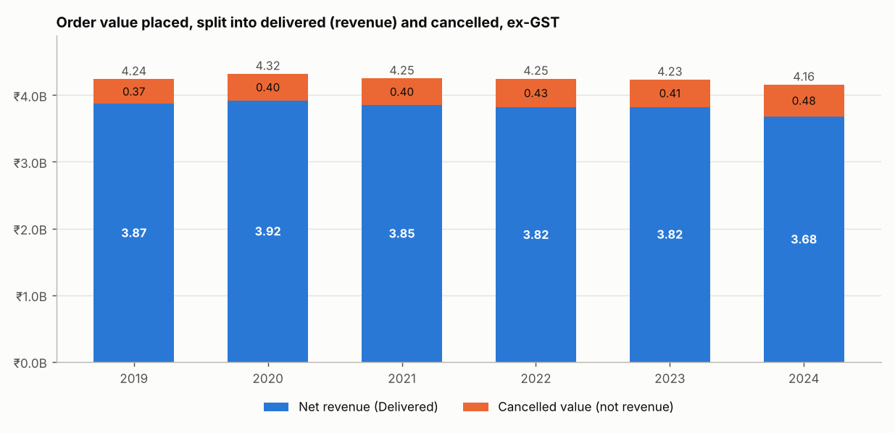
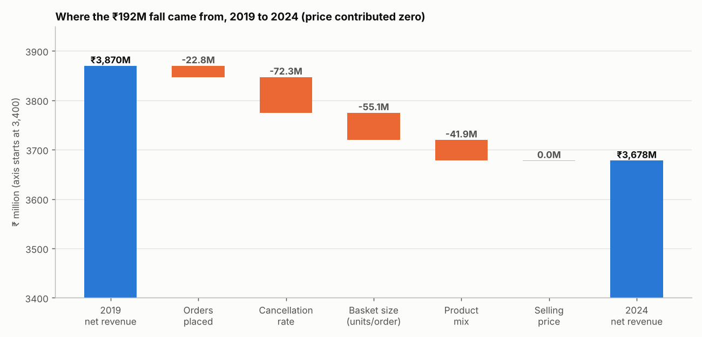
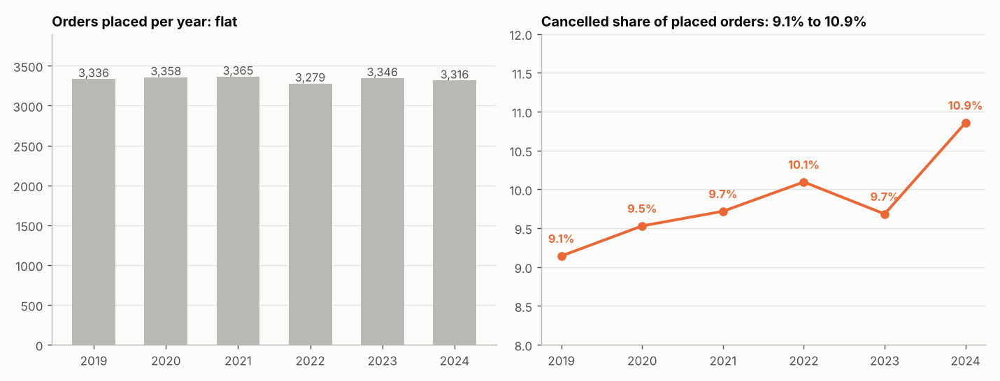
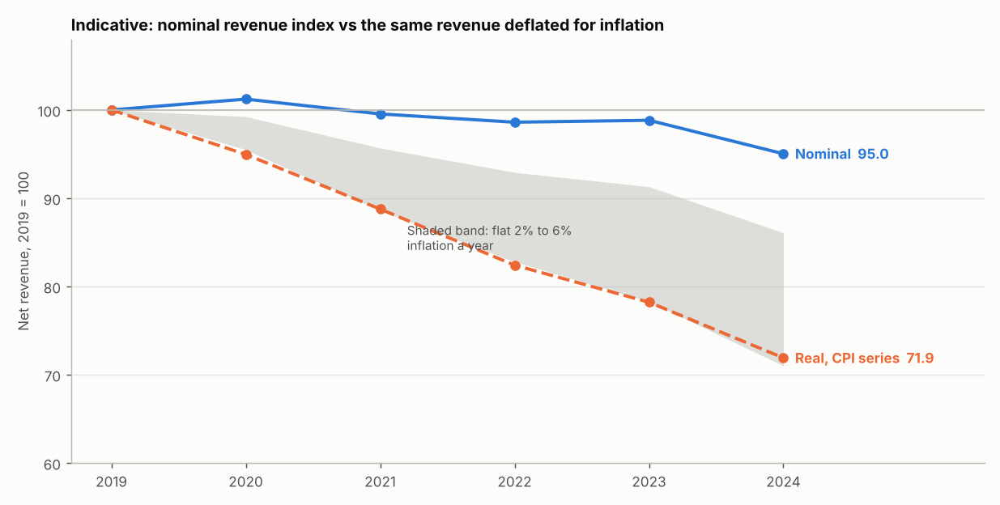

# Week 4 — Q1 Revenue Drift Report (revised)
## Heavy Supplier, Inventory & Warehouse Analytics

**Report date:** 2026-10-24
**Source notebook:** `04_q1_revenue_drift.ipynb`
**Input data:** the corrected Week-2 merged datasets `sales_orders_full` and `invoices_with_payments`; the Week-3 `kpi_revenue_by_year.csv` as the baseline to reproduce
**Output folders:** `q1_outputs/` (tables), `q1_charts/` (charts)
**Status:** Complete — 26 of 26 validation checks passed. One result (real terms) is reported as indicative because it depends on an external assumption (Section 8).

> **Revision note.** The first Q1 version listed the average-order-value drift and the product-mix shift as findings and put a single real-terms figure in the headline. Neither holds up once tested. This version reconciles revenue first, tests every claim, and grades each result as supported, not distinguishable from noise, or indicative (Section 7). **Update after the cancellation drill-down:** the cancellation-rate rise is graded "weak", not "supported", because the six yearly rates are consistent with one constant rate and no segment explains the rise.

**Contents:** 1 Executive summary · 2 Method and definitions · 3 Is the revenue number sound? · 4 When did it happen, and is it real? · 5 Price / mix / volume bridge · 6 Product mix · 7 What survives testing · 8 Real terms (indicative) · 9 Refinement to Week 3 wording · 10 Open issues · 11 Validation checklist · 12 Output files · 13 Conclusion

**Read first:** Sections 1 and 7 give the answer and how strongly each part is supported; Section 10 lists what the team must still ask the data owner.

---

## 1. Executive Summary

**Locked question (Q1).** Net revenue is flat to slightly declining (₹3.87B in 2019 to ₹3.68B in 2024) on steady order volume. Is this pricing, product mix or demand?

| Metric | Value |
|---|---|
| Net revenue 2019 → 2024 | ₹3,870.0M → ₹3,678.0M (**−₹192.0M, −4.96%**) |
| Share of the fall that happened in 2024 alone | **76.4%** (2019 → 2023 was −1.2%); the 2023 → 2024 change itself has a 95% interval of −7.9% to +0.5%, so it cannot be separated from ordinary year-to-year variation |
| Price effect | **₹0.0M by construction, not a finding** — the data holds one price list (all 130,402 lines match the products master, 30 products, one price each); pricing cannot be tested |
| Volume effect | −₹150.1M (78% of the fall) |
| of which orders placed / cancellation rate / basket size | −₹22.8M / −₹72.3M / −₹55.1M |
| Product-mix effect | −₹41.9M (22%), **not distinguishable from noise** (p = 0.47) |
| Orders placed | 3,336 → 3,316 (−0.6%) |
| Cancellation rate | 9.14% → 10.86% (weak trend, p = 0.030; six-year homogeneity p = 0.27) |
| Validation checks | 26 / 26 passed |

**Headlines**
1. **Pricing cannot be tested.** The dataset carries a single price list, so the price effect is zero by construction. The drift is therefore volume and mix; this is a limit of the data, not evidence that prices were stable (confirmed by the data owner's check of the 12 raw tables).
2. **There is no evidence of a fall in demand.** Orders placed are flat (−0.6%) and placed value is down 2.0%, with a 95% interval of −6.0% to +2.3% that includes zero. The data cannot rule out a modest fall of up to about 6%.
3. **Cancellations are the largest identified component, but the evidence for them is weak.** The cancelled share of placed orders rose from 9.1% to 10.9%, and cancelled value rose ₹109.1M (+29.5%), which is 57% of the fall measured from the order book. However, the six yearly rates are consistent with one constant rate (p = 0.27), only a weak linear trend is detectable (p = 0.030), and the Q3 early look found no region, customer type, channel, product, customer or month that explains the rise.
4. **Most of the fall lands in 2024, not across six years.** 2019 to 2023 moved only −1.2% and 2024 holds 76% of the fall. But the single-year change (−3.8%) has a 95% interval of −7.9% to +0.5%, so it is not distinguishable from normal year-to-year variation: describe it as where the fall landed, not as a proven break.
5. **Product mix and average order value are not supported as findings.** Both movements are within random variation.
6. **Real-terms (indicative):** if the single price list reflects real selling prices, revenue is down far more once inflation is considered (about −28% on a CPI series, −14% to −29% across a 2–6% range).

---

## 2. Method and Definitions

| Term | Definition |
|---|---|
| **Net revenue** | `total_order_value` (ex-GST) of Delivered orders |
| **Placed value** | `total_order_value` (ex-GST) of all orders placed |
| **Cancelled value** | ex-GST value of Cancelled orders — reported separately, never counted as revenue |
| Identity | Net revenue = placed value − cancelled value (checked for every year) |
| **Year** | Calendar year of `order_date` (tested in Section 3.3) |
| Price / mix / volume | Exact bridge: volume = ΔQ × base-year average revenue per unit; mix = Σ p₀ × (q₁ − Q₁ × share₀); price = Σ (p₁ − p₀) × q₁. Sums to the revenue change with no residual |
| Volume split | Orders placed × delivery rate × units per delivered order, with a log-mean split so the result does not depend on ordering |

All figures come from the merged datasets, read by explicit file name, with row counts, key uniqueness and totals asserted in the notebook.

---

## 3. Is the Revenue Number Itself Sound?

### 3.1 Tie-out by year (₹B, ex-GST)

| Year | Placed value | Cancelled value | **Net revenue** | Orders placed | Orders delivered | Cancel rate |
|---|---:|---:|---:|---:|---:|---:|
| 2019 | 4.24 | 0.37 | **3.87** | 3,336 | 3,031 | 9.14% |
| 2020 | 4.32 | 0.40 | **3.92** | 3,358 | 3,038 | 9.53% |
| 2021 | 4.25 | 0.40 | **3.85** | 3,365 | 3,038 | 9.72% |
| 2022 | 4.25 | 0.43 | **3.82** | 3,279 | 2,948 | 10.09% |
| 2023 | 4.23 | 0.41 | **3.82** | 3,346 | 3,022 | 9.68% |
| 2024 | 4.16 | 0.48 | **3.68** | 3,316 | 2,956 | 10.86% |

Net revenue by year matches the Week 3 `kpi_revenue_by_year.csv` to the rupee.

### 3.2 Independent cross-check
The invoice table is a separate source. Its ex-GST value, grouped by the order's year, equals net revenue in every year, and the invoices cover exactly the 18,033 Delivered orders. Revenue is computed from orders, so the 393 repeated-ID invoices (open issue UI-01) do not affect Q1.

### 3.3 Is the year basis safe?
- Every year 2019–2024 contains all 12 order months, so the 2024 fall is not a partial-year effect.
- Assigning revenue by **delivery** year was rejected: 2019 would be understated (no December 2018 orders exist in the data) and ₹71.0M of late-December 2024 orders would fall into 2025. The 2024 fall is present on both bases (−3.8% by order year, −4.0% by delivery year).

---

## 4. When Did It Happen, and Is It Real?

| Period | Change | % | Share of total decline |
|---|---:|---:|---:|
| 2019 → 2023 | −₹45.3M | −1.2% | 24% |
| 2023 → 2024 | −₹146.7M | −3.8% | **76%** |
| 2019 → 2024 | −₹192.0M | −4.96% | 100% |

Net revenue = delivered orders × average order value. Delivered orders fell 3,031 → 2,956 (−2.5%, 49% of the decline); average order value fell ₹1,276,812 → ₹1,244,247 (−2.6%, 51% of the decline).

**The 2023 → 2024 step on its own (₹146.7M).** Delivered orders fell 3,022 → 2,956 (−2.2%, recounted from `order_status`) while revenue fell 3.8%, so about 57% of the step is fewer delivered orders and 43% is lower value per order. Fewer delivered orders combines two things: fewer orders placed (3,346 → 3,316, ₹34.0M, 23%) and a higher cancellation rate (9.7% → 10.9%, ₹49.4M, 34%). Cancellations alone are therefore about a third of this step, not half; product mix is ₹57.3M (39%) and basket size ₹5.9M (4%). The cancellation rate is not a steady rise (9.1, 9.5, 9.7, 10.1, 9.7, 10.9%): 2024 is a jump after a dip in 2023. Single-year mix effects flip sign, so the mix share is not reliable.

**Wording for the 2023 → 2024 step (agreed with the team).** Order volume (fewer orders placed plus a higher cancellation rate) explains about 57% of the fall and value per order about 43%. Product mix is the largest single component of this step (39%), then the cancellation rate (34%), but neither is statistically distinguishable from year-to-year variation (mix permutation for this step p = 0.34, and p = 0.47 for 2019 → 2024; cancellation-rate homogeneity p = 0.27).

**Method note.** The bridge applies effects in a fixed order: volume at base-year average revenue per unit, mix at base-year prices, price at current quantities. The three volume parts (orders placed, cancellation rate, basket size) use a log-mean split, so their order does not matter, and all shares add to 100% with no residual. Re-running the 2023 → 2024 bridge with end-year weights moves the mix share only from 39.1% to 40.0%, so the convention does not change the conclusion.

A bootstrap on order values gives a 95% interval of −9.0% to −0.8% for the 2019 → 2024 change (order counts treated as given), so the fall is distinguishable from zero, but only narrowly.

---

## 5. Price / Mix / Volume Bridge

### 5.1 Price
Zero of 30 products have more than one `unit_price` in any year or across years. The price effect is **₹0 by construction**: every order line matches the products master and the master has no price history. This is a limitation of the data, not a finding about pricing.

### 5.2 Bridge, 2019 → 2024 (₹M)

| Effect | ₹M | Share of fall | Reading |
|---|---:|---:|---|
| Price | 0.0 | 0% | Single price list (data limit) |
| Orders placed | −22.8 | 12% | Placed orders −0.6%: no evidence of a demand fall |
| Cancellation rate | −72.3 | 38% | Rate 9.14% → 10.86% at constant demand and basket |
| Basket size | −55.1 | 29% | Units per delivered order 68.6 → 67.6 |
| Product mix | −41.9 | 22% | Not distinguishable from noise (Section 6) |
| **Total** | **−192.0** | 100% | |

Year-by-year bridges are in `q1_price_mix_volume_bridge.csv`. Components swing in both directions from year to year (for example mix: −28.5, +4.0, +75.3, −36.8, −57.3M), so single-year components should not be read as trends.

### 5.3 The same fall from the order book

| ₹M | 2019 | 2024 | Change |
|---|---:|---:|---:|
| Placed value | 4,240.2 | 4,157.2 | −83.0 (−2.0%) |
| Cancelled value | 370.1 | 479.2 | +109.1 (+29.5%) |
| **Net revenue** | **3,870.0** | **3,678.0** | **−192.0** |

**How to read the two views.** The order-book view is an accounting identity: 43% of the fall is lower placed value (not distinguishable from zero) and 57% is higher cancelled value. The bridge isolates the cancellation *rate* at constant demand and basket (−72.3M), so it is smaller than the +109.1M rise in cancelled value, which also reflects the slightly higher value of cancelled orders in 2024 (₹1.33M vs ₹1.21M; not significant, p = 0.18). Both views agree that cancellations are the largest identified component; neither can show that the rise in the cancellation rate is more than a weak trend (Section 7).

---

## 6. Product Mix

- Unit share moved away from Engine (−₹47.3M mix effect), Hydraulic (−₹37.3M) and Undercarriage (−₹19.7M) parts and towards Transmission (+₹50.4M, mainly Transmission Assembly TA-800 at +0.31 pp share and a ₹83,500 unit price).
- Largest product contributions: Swing Motor SWM-350 −₹28.8M, Engine Block EB-600 −₹27.6M, Turbocharger TB-900 −₹22.7M, Track Chain TC-45 −₹20.7M; Transmission Assembly TA-800 +₹50.4M.
- Average revenue per unit at constant 2019 prices went 18,613 → 18,403 (−1.1%) and peaked at 18,870 in 2022, so there is no steady drift towards cheaper products.
- A permutation test (5,000 shuffles of the year label across whole orders) gives a shuffled 95% range of −₹116M to +₹117M. The observed −₹41.9M sits well inside it (p = 0.47). The same test on the 2023 → 2024 step alone (−₹57.3M, shuffled range −₹119M to +₹118M) gives p = 0.34. **Mix is withdrawn as a finding.**

---

## 7. What Survives Testing

| Claim | Evidence | Verdict |
|---|---|---|
| No price effect | 0 of 30 products change price; master has no price history | **Not testable**: a limit of the data, not a finding |
| No evidence of a fall in demand | −0.6% orders; placed value −2.0%, interval −6.0% to +2.3% | **Not distinguishable from flat** (a modest fall cannot be ruled out) |
| Cancellation rate rose | 9.14% → 10.86%. Six-year homogeneity p = 0.27 (consistent with one constant rate); linear trend (Cochran-Armitage) p = 0.030; 2019 vs 2024 endpoints p = 0.022, but those endpoints were chosen after looking | **Weak**: a trend is detectable, no single year differs, and no segment explains it (Q3 early look) |
| Net revenue fell 2019 → 2024 | Bootstrap interval −9.0% to −0.8% | **Supported** (narrowly) |
| Decline lands mostly in 2024 | 76% of the fall; 2019 → 2023 −1.2%; 2023 → 2024 interval −7.9% to +0.5% | **Descriptive only**: true as arithmetic, but the 2024 change is not statistically distinguishable from zero |
| Average order value drifted down | ₹1.277M → ₹1.244M; Welch p = 0.24; trend p = 0.21 | **Not distinguishable from noise — withdrawn** |
| Mix shifted against high-value parts | Permutation p = 0.47 (2019 → 2024); p = 0.34 (2023 → 2024 step) | **Not distinguishable from noise — withdrawn** |
| Cancelled orders became more valuable | ₹1.21M → ₹1.33M; p = 0.18 | **Not distinguishable from noise** |
| Real-terms decline of about 28% | Depends on a general CPI series | **Indicative** (Section 8) |

---

## 8. Real Terms (Indicative)

If selling prices really never changed (the data cannot confirm this), inflation-adjusted revenue falls faster than nominal revenue. The CPI series (India, 2020–2024: 6.6%, 5.2%, 6.7%, 5.6%, 4.6%; focus-economics.com, macrotrends.net) is **general consumer inflation, not a price index for heavy-machinery parts**, so the result is an order of magnitude, not a precise figure.

| | 2019 | 2024 | Change |
|---|---:|---:|---:|
| Nominal net revenue | ₹3.87B | ₹3.68B | −5.0% |
| Revenue in 2019 rupees (CPI series) | ₹3.87B | ₹2.78B | −28.1% |
| Revenue per unit in 2019 rupees | ₹18,613 | ₹13,924 | −25.2% |
| Revenue needed to keep pace with the CPI series | — | ₹5.12B vs ₹3.68B actual | shortfall ₹1.44B |

Sensitivity to a flat annual inflation rate: 0% → −5.0%, 2% → −13.9%, 3% → −18.0%, 4% → −21.9%, 5% → −25.5%, 6% → −29.0%. At any plausible rate the real-terms fall is several times the nominal one.

---

## 9. Refinement to Week 3 Wording

| Where | Week 3 statement | Refinement |
|---|---|---|
| `Week3_KPI_Report.md` §3.2; `sales_kpi_summary.md` §3 | "Order counts are steady, so the decline comes from value per order, not order count" | Orders **placed** are steady (3,279–3,365), but orders **delivered** fell 2.5% (3,031 → 2,956) because more orders were cancelled. Delivered orders and average order value each explain about half of the fall, and the average-order-value part is not distinguishable from noise |
| Locked Q1 wording | "Average order value drifted from ₹1.28M to ₹1.24M — is this pricing, product mix or demand?" | Answer: not pricing (zero), no evidence of a demand fall, mix unproven; the identified driver is cancellations, landing mostly in 2024 |

---

## 10. Open Issues & Limitations

| ID | Area | Issue | Impact | Owner |
|---|---|---|---|---|
| UI-Q1-01 | Pricing | `unit_price` is identical in every year for all 30 products | **Confirmed by raw-table check:** all 130,402 lines match the products master, which has no price history, so it is a snapshot of one price list. Price effect cannot be tested; the real-terms view is conditional on prices having really been frozen. Open question for the business: were selling prices changed in 2019–2024? | Data owner / Sales |
| UI-Q1-02 | Cancellations | No cancellation-reason field | Customer-driven and supply-driven cancellations cannot be separated. The Q3 early look found the rate is statistically uniform across region, customer type, channel, branch, payment terms, product, customer and month | Data owner (confirmed: no reason field in any of the 12 raw tables; closest proxy is the segment cuts in Q3) |
| UI-Q3-01 | Order status | All 1,967 cancelled orders carry a delivery date and a lead time identical to delivered orders | Cancellation cannot be linked to anything else in the data; confirm what a Cancelled status means | Data owner |
| UI-Q1-03 | Deflator | Only a general CPI series is available | Real-terms figure is indicative; agree a deflator (CPI or a parts price index) before it is quoted outside the team | BI Analysts |
| UI-Q1-04 | Discounts | No list-price or discount field | Realised price equals list price; discount erosion cannot be measured | Data owner |
| UI-01 (existing) | Invoices | 196 repeated `invoice_id` values | Confirmed **not** to affect Q1: revenue is computed from orders and agrees with the invoice table | Finance / IT |

Further limitations: significance tests treat orders as independent (repeat customers can make them slightly optimistic); six annual points give limited power for trend claims; revenue is Delivered orders only, ex-GST.

---

## 11. Validation Checklist (26 / 26 passed)

| # | Check | Result |
|---|---|---|
| 1–5 | Row counts (sales 130,402; invoices 18,033), sales key unique, 20,000 orders, no `_x/_y` columns | ✅ PASS |
| 6–8 | Order header total = sum of lines; delivered + cancelled = 20,000; net revenue (lines) = delivered order totals | ✅ PASS |
| 9 | Placed value − cancelled value = net revenue, every year | ✅ PASS |
| 10–11 | Net revenue and delivered orders by year = Week 3 `kpi_revenue_by_year.csv` | ✅ PASS |
| 12–13 | Net revenue by year = invoice table; invoices cover exactly the delivered orders | ✅ PASS |
| 14 | All 12 order months in every year (72 in total) | ✅ PASS |
| 15 | Delivered orders × average order value = net revenue, every year | ✅ PASS |
| 16 | One `unit_price` per product in every year | ✅ PASS |
| 17–19 | Price + mix + volume = change; orders + cancellation rate + basket = volume; chained yearly changes = total | ✅ PASS |
| 20–24 | Mix by product sums to mix effect; same 30 products in 2019 and 2024; permutation statistic reproduces the bridge for 2019 → 2024 and for 2023 → 2024; 2023 → 2024 mix effect is not distinguishable from noise (p = 0.34) | ✅ PASS |
| 25 | Real revenue in 2019 = nominal revenue in 2019 | ✅ PASS |

Full detail: `validation_report_week04_q1.csv`.

---

## 12. Output Files

| File | Description |
|---|---|
| `04_q1_revenue_drift.ipynb` | Reproducible notebook, executed end to end with outputs and charts saved; stops if any check fails |
| `Q1_Revenue_Drift_Report.md` | This report |
| `validation_report_week04_q1.csv` | 26 checks (Check_Item, Expected, Actual, Status) |
| `q1_outputs/` | `q1_revenue_chain_by_year`, `q1_year_basis_check`, `q1_timing_of_decline`, `q1_price_mix_volume_bridge`, `q1_order_book_view`, `q1_mix_effect_by_product/category`, `q1_unit_price_check`, `q1_significance_tests`, `q1_real_terms_revenue`, `q1_inflation_sensitivity` |
| `q1_charts/` | 4 charts (PNG) |

**To run:** open the notebook anywhere inside the repository checkout. It searches this folder and every parent folder for the merged files and the Week 3 baseline. Otherwise put a `merged/` and a `kpi_outputs/` folder next to the notebook, or set the environment variables `CADETX_MERGED` and `CADETX_KPI` to the two folders. If it cannot find them it stops with a message saying so. Tested from a clean copy of the repository layout (0 errors, 25 of 25 checks).

---

## 13. Conclusion

Q1 is answered. The ₹192.0M fall in net revenue is **not shown to be pricing** (the data holds one price list, so pricing cannot be tested) and **no evidence of a fall in demand** (orders placed are flat, within noise). The largest identified components are fulfilment effects (more cancellations and slightly smaller delivered baskets, landing mostly in 2024), but the evidence for each is weak: the cancellation rate shows only a weak trend and no segment explains it. Product mix and average order value are not supported as findings. In real terms the decline is considerably larger, because the price list did not move.

**Caveats for Phase 2**
- Quote the real-terms figure only as indicative, with the 2–6% range, until a deflator is agreed.
- Do not describe Q1 as a product-mix problem or as an average-order-value problem.
- Do not draw any pricing conclusion: the single price list is a data limitation (UI-Q1-01, confirmed by the data owner's raw-table check).

**Next (Phase 2):** ask the business whether selling prices really changed in 2019–2024, and the data owner what a Cancelled status means (see `Q3_Cancellations_Early_Look.md` for the cancellation drill-down, which found no concentrated source).
