# Week 3 — KPI Calculations Report
## Heavy Supplier, Inventory & Warehouse Analytics

**Report date:** 2026-10-18
**Source notebook:** `week-03/03_kpi_calculations.ipynb`
**Input data:** the five corrected Week-2 merged datasets (`sales_orders_full`, `invoices_with_payments`, `purchase_orders_full`, `inventory_with_ledger`, `stock_ledger_enriched`)
**Output folders:** `kpi_outputs/` (tables), `exploratory_charts/` (charts)
**Status:** Complete — 22 of 22 validation checks passed. Three KPI areas are reported as data limitations rather than findings (Section 8).

---

## 1. Executive Summary

| Metric | Value |
|---|---|
| Orders (total / delivered / cancelled) | 20,000 / 18,033 / 1,967 (9.84% cancelled) |
| **Net revenue** (Delivered, ex-GST) | **₹22.96B** |
| Gross revenue incl. GST / GST collected | ₹29.25B / ₹6.30B |
| Cancelled order value (not revenue) | ₹2.49B |
| Average order value (net) | ₹1.27M |
| Gross profit / margin | ₹4.95B / 21.6% |
| Average delivery lead time | 8.06 days (median 8.0) |
| Invoices by status (Paid / Partially Paid / Unpaid) | 12,536 / 3,660 / 1,837 |
| Outstanding (reliable invoices) | ₹5.80B — 86% more than 365 days overdue |
| Supplier on-time delivery | 84.2–85.6% for all 8 suppliers |
| Units received vs units sold | 18.1× |
| Stock vs ledger mismatches | 14 of 180 product–branch pairs |
| Validation checks | 22 / 22 passed |

**Headlines**
1. Net revenue is **flat to slightly declining** (₹3.87B in 2019 → ₹3.68B in 2024); order volume is steady, so average order value is drifting down.
2. South and West generate 60.9% of net revenue. Engine Block EB-600 and Transmission Assembly TA-800 are 36.0% of revenue at below-average margins.
3. Payment risk is an **ageing problem, not a segment problem**: outstanding is 19–21% of value in every customer type and region, but most of it is over a year old.
4. The 8 suppliers are **practically indistinguishable** on every measure.
5. **Stock-based KPIs cannot be reported.** Purchase receipts are 18× units sold, so stock is on a different scale from its own thresholds.

---

## 2. Method and Definitions

All figures come from the merged datasets, read by explicit file name, with row counts, key uniqueness and totals asserted in the notebook.

| Term | Definition |
|---|---|
| **Net revenue** | `total_order_value` (ex-GST) of Delivered orders |
| Gross revenue | `grand_total` (incl. GST) of Delivered orders |
| Cancelled value | ex-GST value of Cancelled orders — reported separately, never counted as revenue |
| Gross profit | `quantity × (unit_price − unit_cost)` on Delivered lines |
| Reliable invoice | invoice with a unique `invoice_id`; the only invoices whose payments can be attributed |
| As-of date | 2025-03-14, the latest invoice due date in the data (used for overdue/ageing) |

Order status is either `Delivered` or `Cancelled`. Every Delivered order has exactly one invoice (18,033); every Cancelled order has none (1,967).

---

## 3. Sales & Customer KPIs

### 3.1 Top-line

| KPI | Value |
|---|---:|
| Net revenue | ₹22,958,987,430 |
| Average order value (net) | ₹1,273,165 |
| Gross profit | ₹4,950,006,740 |
| Gross margin (% of net revenue) | 21.56% |
| Cancellation rate | 9.84% |

### 3.2 Net revenue by year

| Year | Net revenue | Orders | Avg order value | YoY |
|---|---:|---:|---:|---:|
| 2019 | ₹3.87B | 3,031 | ₹1.28M | — |
| 2020 | ₹3.92B | 3,038 | ₹1.29M | +1.2% |
| 2021 | ₹3.85B | 3,038 | ₹1.27M | −1.7% |
| 2022 | ₹3.82B | 2,948 | ₹1.29M | −0.9% |
| 2023 | ₹3.82B | 3,022 | ₹1.27M | +0.2% |
| 2024 | ₹3.68B | 2,956 | ₹1.24M | −3.8% |

2024 is the lowest year (−5.0% vs 2019). Order counts are steady (~3,000 a year), so the decline comes from value per order.

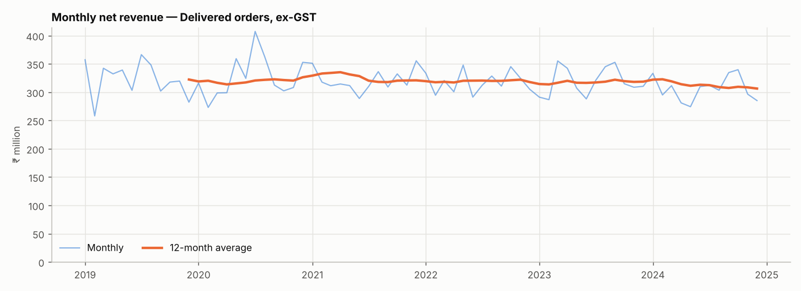
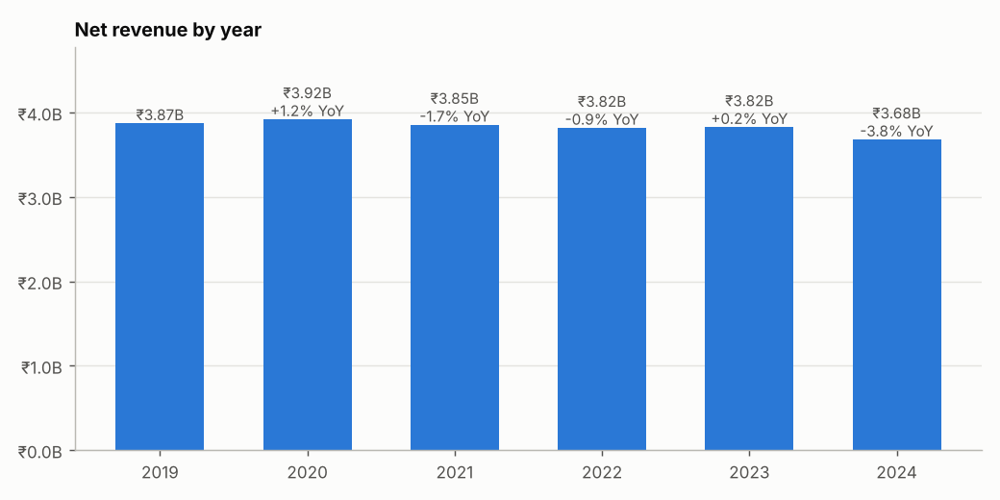

### 3.3 Customer type and region

| Customer type | Net revenue | Share | Avg order value | Orders |
|---|---:|---:|---:|---:|
| Government | ₹5.05B | 22.0% | ₹1.24M | 4,075 |
| Corporate | ₹4.72B | 20.5% | ₹1.28M | 3,672 |
| Dealer | ₹4.68B | 20.4% | ₹1.29M | 3,633 |
| Fleet Owner | ₹4.41B | 19.2% | ₹1.28M | 3,457 |
| Retail | ₹4.10B | 17.8% | ₹1.28M | 3,196 |

| Region | Net revenue | Share | Orders |
|---|---:|---:|---:|
| South | ₹7.26B | 31.6% | 5,722 |
| West | ₹6.73B | 29.3% | 5,335 |
| East | ₹4.05B | 17.6% | 3,161 |
| North | ₹3.94B | 17.2% | 3,029 |
| Central | ₹0.50B | 2.2% | 406 |
| North East | ₹0.47B | 2.1% | 380 |

Government leads through order **count**, not order size (average order values are within ₹1.24–1.29M). South and West together are 60.9% of net revenue; Central and North East are about 2% each. The regional shares are stable across all six years.

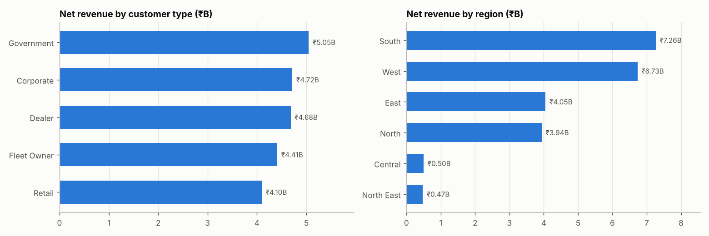
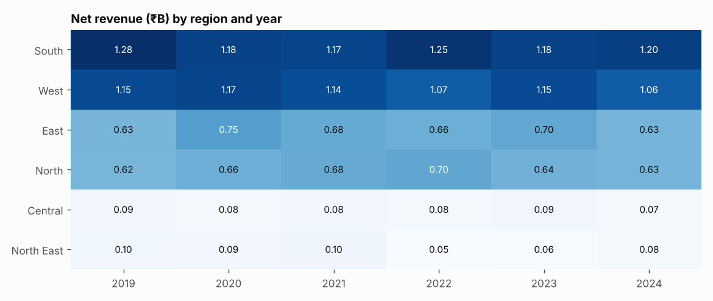

### 3.4 Delivery lead time (Delivered orders)

Average 8.06 days, median 8.0, spread evenly across 1–15 days. By region: Central 7.56 · North East 7.72 · East 7.94 · North 8.00 · South 8.13 · West 8.16 — no regional bottleneck.

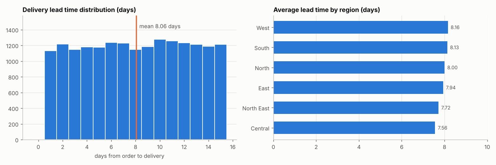

### 3.5 Top products

| Product | Net revenue | Share | Gross profit | Margin |
|---|---:|---:|---:|---:|
| Engine Block EB-600 | ₹4.86B | 21.2% | ₹0.96B | 19.7% |
| Transmission Assembly TA-800 | ₹3.39B | 14.8% | ₹0.61B | 18.0% |
| Boom Cylinder BC-400 | ₹1.93B | 8.4% | ₹0.44B | 22.9% |
| Swing Motor SWM-350 | ₹1.65B | 7.2% | ₹0.36B | 21.6% |
| Track Chain TC-45 | ₹1.63B | 7.1% | ₹0.30B | 18.3% |

The top two products are **36.0%** of net revenue at margins (19.7%, 18.0%) below the 21.6% average. Low-revenue products carry the highest margins (up to ~46%).

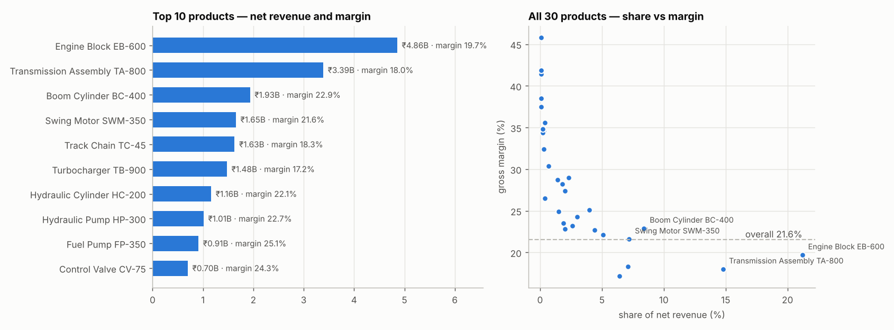

---

## 4. Order Status, Payments & Credit Risk

### 4.1 Status

| Order status | Orders | % |
|---|---:|---:|
| Invoiced (Delivered) | 18,033 | 90.2% |
| Cancelled (no invoice) | 1,967 | 9.8% |

| Payment status | Invoices | % | Invoice value (incl. GST) | % of value |
|---|---:|---:|---:|---:|
| Paid | 12,536 | 69.5% | ₹20.30B | 69.4% |
| Partially Paid | 3,660 | 20.3% | ₹5.97B | 20.4% |
| Unpaid | 1,837 | 10.2% | ₹2.98B | 10.2% |

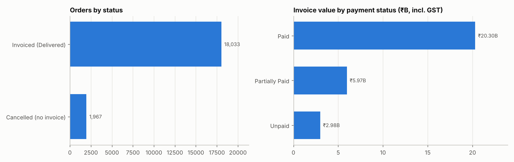

### 4.2 Outstanding and ageing

Payment totals can only be attributed for the **17,640 invoices with a unique `invoice_id`**. The other 393 invoices (₹654M incl. GST) share an ID with another invoice, so their payments cannot be matched (open issue UI-01) and they are excluded below.

| Metric | Value |
|---|---:|
| Outstanding (reliable invoices) | ₹5.80B |
| Overdue invoices | 5,375 |
| More than 365 days overdue | ₹4.99B — 86% of outstanding (4,595 invoices) |

| Days past due | Invoices | Outstanding |
|---|---:|---:|
| Not overdue | 12,265 | ₹0.00B |
| 1–30 | 17 | ₹0.01B |
| 31–90 | 119 | ₹0.11B |
| 91–180 | 224 | ₹0.24B |
| 181–365 | 420 | ₹0.44B |
| > 365 | 4,595 | ₹4.99B |

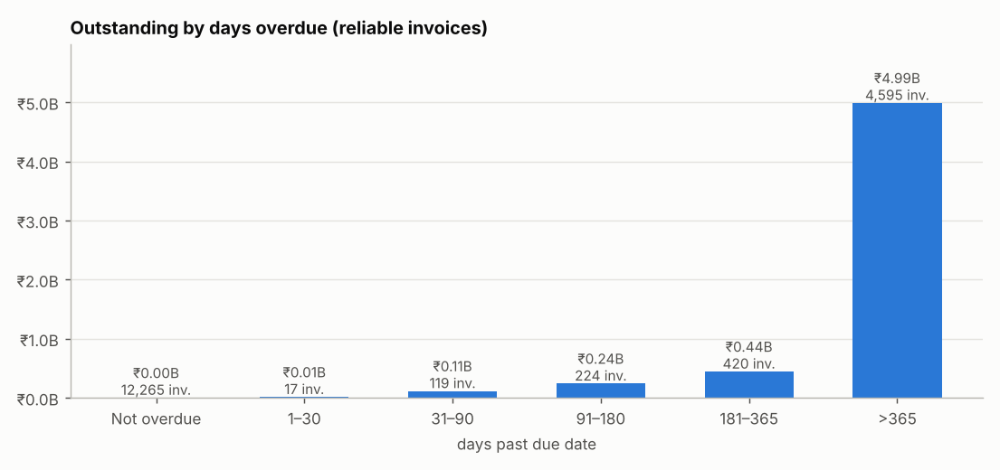

### 4.3 Is credit risk concentrated?

**No.** Outstanding is 19.6–21.4% of invoice value in every customer type (Corporate highest at 21.4%) and 18.6–20.9% in every region. Unpaid invoices are 9.1–11.0% of invoices in every customer type. The risk is that most outstanding money is more than a year old, not that a segment is worse than another.

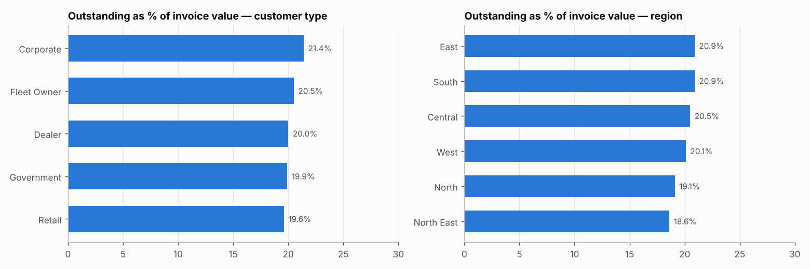

---

## 5. Supplier KPIs

Measured on what was bought and received. Every one of the 30 products is bought from **all 8 suppliers** (top supplier's share of a product averages 13.3%; an even split is 12.5%), so a "primary supplier per product" or supplier-level sales revenue is not meaningful and is not reported.

| Supplier | Type | Spend (ex-GST) | Share | On-time | Avg delay (d) | Actual vs contract lead time (d) | PO cancel rate | Reliability score |
|---|---|---:|---:|---:|---:|---|---:|---:|
| Tianjin OEM | OEM | ₹40.26B | 12.9% | 85.3% | 0.48 | 28.5 vs 28 | 9.5% | 3 |
| Shenzhen OEM | OEM | ₹39.44B | 12.6% | 85.3% | 0.48 | 19.5 vs 19 | 9.9% | 5 |
| Hangzhou OEM | OEM | ₹39.25B | 12.6% | 84.2% | 0.54 | 26.5 vs 26 | 9.6% | 4 |
| Shanghai Distributor | Distributor | ₹39.19B | 12.6% | 85.4% | 0.53 | 16.5 vs 16 | 10.2% | 4 |
| Qingdao Distributor | Distributor | ₹39.11B | 12.5% | 85.6% | 0.48 | 10.5 vs 10 | 9.4% | 3 |
| Suzhou Local Vendor | Local Vendor | ₹39.05B | 12.5% | 84.3% | 0.55 | 12.6 vs 12 | 9.9% | 5 |
| Ningbo Distributor | Distributor | ₹38.03B | 12.2% | 84.4% | 0.51 | 18.5 vs 18 | 10.2% | 3 |
| Guangzhou Local Vendor | Local Vendor | ₹37.72B | 12.1% | 85.0% | 0.51 | 10.5 vs 10 | 10.3% | 5 |

- Suppliers are **statistically indistinguishable**: on-time rate 84.2–85.6%, cancellations 9.4–10.3%, spend share 12.1–12.9%.
- Every supplier delivers on average about half a day later than its contracted lead time.
- The master-data `reliability_score` does **not** track observed delivery (correlation −0.20 across 8 suppliers) and should not be used as a proxy for performance.
- Purchase spend (~₹312B ex-GST) is about 14× net sales revenue — the same scale gap described in Section 6.

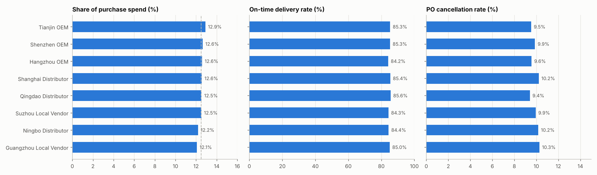
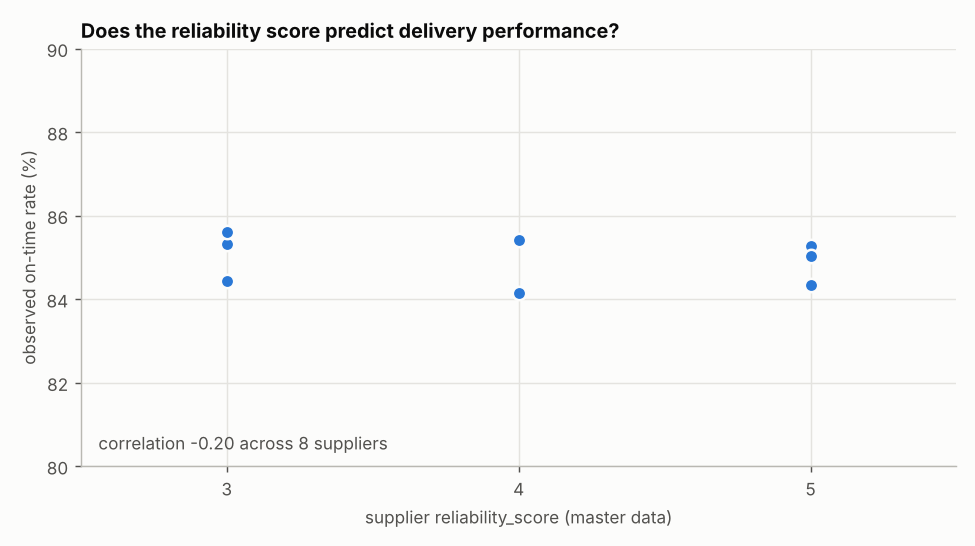

---

## 6. Product, Inventory & Warehouse

### 6.1 The stock scale problem

| Field | Mean | Range |
|---|---:|---|
| `current_stock` | 107,240 | 88,853 – 121,013 |
| `opening_stock` | 183 | 80 – 300 |
| `max_stock` | 322 | 131 – 582 |
| `reorder_level` | 65 | 24 – 119 |
| `safety_stock` | 45 | 16 – 85 |

All 180 product–branch pairs sit above `max_stock`; none is below its reorder level.

**Cause.** The fields are not in different units — the inflow is on a different scale from the outflow:

| Flow | Units |
|---|---:|
| Units sold (Delivered orders) | 1,234,939 |
| Units received on purchase orders | 22,387,123 (**18.1× sold**) |
| Ledger IN / OUT | 20,397,795 / 1,124,832 (18.1×) |

Stock starts at ~200 units (matching the thresholds) and then receives about 18× more than it ships. Every product shows the same pattern (received ÷ sold = 17.4–19.2). Stock value at cost is ≈₹281B against net sales of ₹23B.

Consequently, **stock-based KPIs (turnover, stock cover, stock health, replenishment policy) are not reported as findings** until the data owner confirms which side (PO quantities or sales/stock thresholds) is on the wrong scale. `kpi_inventory_turnover.csv` keeps the received-to-sold ratio and an `indicative_turnover` column explicitly labelled as not valid.

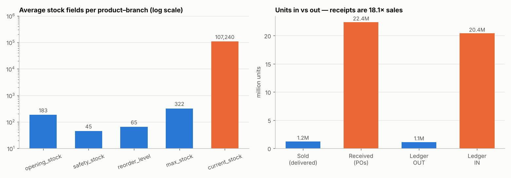
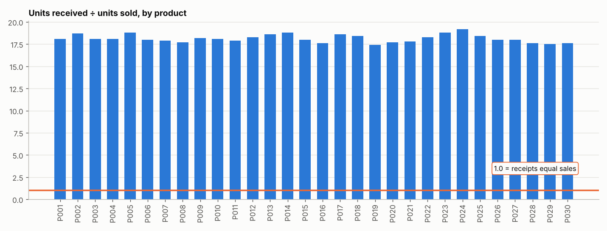

### 6.2 Ledger vs inventory master

14 of 180 pairs differ (range −515 to +16 units); **13 of 14 are negative** (ledger higher than `current_stock`), so the discrepancy is one-directional. The ledger chain is consistent in file order; only `ADJUSTMENT` rows break it, because their quantity is unsigned although about half of them reduce stock. The affected pairs depend on ordering the ledger by date then file position, not by `movement_id`.

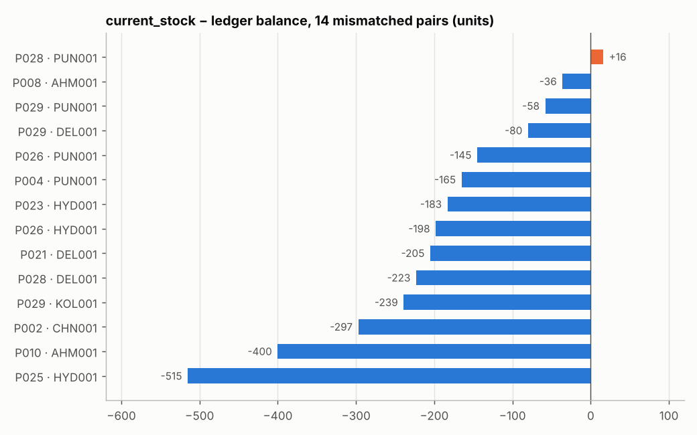

### 6.3 Branch view

| Branch | Net revenue | Orders | Avg stock / product | Mismatched pairs | Capacity (sq ft) | Employees | Revenue / employee |
|---|---:|---:|---:|---:|---:|---:|---:|
| Chennai South Hub | ₹4.68B | 3,677 | 107,808 | 1 | 41,890 | 81 | ₹57.8M |
| Kolkata East Depot | ₹4.34B | 3,413 | 104,127 | 1 | 29,880 | 49 | ₹88.6M |
| Ahmedabad West Hub | ₹3.99B | 3,115 | 105,166 | 2 | 34,120 | 63 | ₹63.3M |
| Delhi Central | ₹3.50B | 2,682 | 109,622 | 3 | 45,230 | 92 | ₹38.0M |
| Pune Distribution | ₹3.37B | 2,668 | 108,542 | 4 | 38,750 | 74 | ₹45.6M |
| Hyderabad Logistics | ₹3.08B | 2,478 | 108,176 | 3 | 36,210 | 57 | ₹54.0M |

Revenue per employee is highest at Kolkata and lowest at Delhi (the largest, best-staffed warehouse).

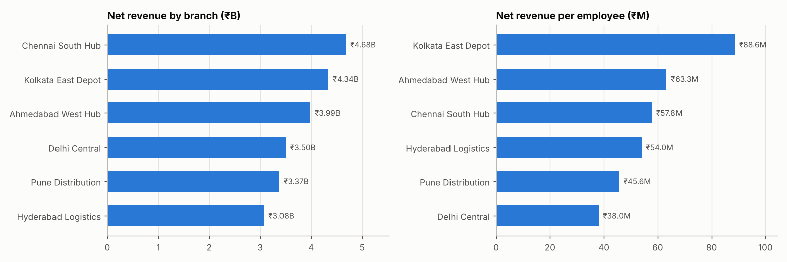

---

## 7. Corrections Made to the First Week-3 Version

| Issue | What was wrong | Resolution |
|---|---|---|
| Revenue overstated | Headline ₹32.42B was `grand_total` (incl. GST) over all orders incl. 1,967 Cancelled | Net revenue ₹22.96B (ex-GST, Delivered); gross, GST and cancelled value shown separately; average order value ₹1.27M (was ₹1.62M) |
| "Not Invoiced" label | 2,360 = 1,967 Cancelled orders + 393 orders whose invoices were set aside | Replaced by "Cancelled"; the 393 invoices are back in the base. Unpaid is 10.2% of invoices, not 9.0% of orders |
| Supplier assignment | "Supplier of most recent PO" per product, although all products use all 8 suppliers (15 products were decided by a Cancelled PO) | Withdrawn; supplier KPIs computed from PO activity |
| Stock health & turnover | Quantile classes are ~25/50/25 by construction; turnover divided units sold by ~107,000 units of stock | Withdrawn as findings; replaced by the scale diagnostic |
| Profit | Not reported | Added from corrected `line_profit` (₹4.95B, 21.6%) |
| Payment attribution | 393 repeated-ID invoices cannot be matched to payments | Excluded from outstanding/overdue; reported separately (₹654M) |
| Reproducibility | Notebook read a file not in the submission; 2 cells unexecuted | Reads the five merged files by name; runs end to end with outputs and charts saved |
| Stale files | `kpi_tables.csv` said supplier mix unavailable; mismatches quoted as 6 | Regenerated from the notebook; mismatches = 14 |

---

## 8. Open Issues & Limitations

| ID | Area | Issue | Impact | Owner |
|---|---|---|---|---|
| UI-01 | Invoices | 196 repeated `invoice_id` values (393 rows); 201 repeated `payment_id` values | Payments cannot be attributed to ₹654M of invoices | Finance / IT |
| UI-03 | Inventory | `ADJUSTMENT` quantities are unsigned; 14 pairs differ between master and ledger | Stock balances uncertain; confirm authoritative source | Warehouse / Ops |
| UI-06 | Purchasing / stock | PO receipts are 18× units sold (PO spend ≈ ₹312B vs sales ₹23B) | Stock-based KPIs not reportable; procurement conclusions unreliable | Data owner |
| UI-07 | Customer master | Many orders predate `customer_since` (5,857 of 20,000 in the earlier dataset); not re-checked in this version | Customer-tenure analysis unsafe | Data Analyst |
| — | Overdue ageing | As-of date is the latest due date in the data (2025-03-14), not today | Ageing buckets are relative to that date | — |

---

## 9. Validation Checklist (22 / 22 passed)

| # | Check | Result |
|---|---|---|
| 1–8 | Row counts (sales 130,402, invoices 18,033, PO lines 155,495, inventory 180, ledger 237,230), unique orders 20,000, sales key unique, no `_x/_y` columns | ✅ PASS |
| 9 | Order header total = sum of lines (all orders) | ✅ PASS |
| 10 | Delivered + Cancelled = 20,000 | ✅ PASS |
| 11 | Net revenue (lines) = delivered order totals | ✅ PASS |
| 12 | `line_profit` = quantity × (price − cost) on every row | ✅ PASS |
| 13–14 | Invoices = Delivered orders, and cover exactly the same orders | ✅ PASS |
| 15 | Reliable + unreliable invoices = 18,033 | ✅ PASS |
| 16 | No negative outstanding amounts | ✅ PASS |
| 17 | Reliable Paid invoices are fully paid | ✅ PASS |
| 18 | Every product is bought from 8 suppliers | ✅ PASS |
| 19 | PO headers = 24,000 | ✅ PASS |
| 20 | Cancelled POs have no received date | ✅ PASS |
| 21 | All 180 pairs exceed `max_stock` (scale diagnostic) | ✅ PASS |
| 22 | Stock vs ledger mismatches = 14 | ✅ PASS |

Full detail: `validation_report_week03.csv`.

---

## 10. Output Files

| File | Description |
|---|---|
| `03_kpi_calculations.ipynb` | Reproducible notebook with 15 inline charts |
| `sales_kpi_summary.md`, `supplier_kpi_summary.md`, `inventory_kpi_summary.md` | Area summaries |
| `sprint_notes_week03.md`, `analysis_questions_locked.md` | Sprint notes and locked Phase-2 questions |
| `validation_report_week03.csv` | 22 checks |
| `data_dictionary_columns.csv` | Columns of the five merged datasets |
| `kpi_outputs/` | `kpi_tables`, `kpi_revenue_by_year/month/customer_type/region`, `kpi_lead_time_by_region`, `kpi_top_products`, `kpi_order_status`, `kpi_payment_status_breakdown`, `kpi_outstanding_summary`, `kpi_payment_aging`, `kpi_credit_risk_by_customer_type/region`, `kpi_supplier_performance`, `kpi_stock_scale_check`, `kpi_stock_scale_flows`, `kpi_inventory_turnover`, `kpi_stock_ledger_mismatches`, `kpi_branch_summary` |
| `exploratory_charts/` | 15 charts (PNG) |

---

## 11. Conclusion

Week 3 produced validated sales, payment, supplier and branch KPIs on the corrected merged datasets. Net revenue is ₹22.96B, flat to slightly declining, concentrated in South and West and in two products with below-average margins. Payment risk is about ageing (86% of ₹5.80B outstanding is over a year old), not about any customer segment. The eight suppliers cannot be told apart on delivery, cancellation or spend.

Stock-based KPIs are deliberately not reported: purchase receipts are 18× units sold, so stock sits two to three orders of magnitude above its own thresholds. This must be confirmed with the data owner before Phase 2 work on turnover, replenishment or procurement.

**Caveats for Phase 2**
- Use net revenue (ex-GST, Delivered) for revenue analysis; use `payment_total_reliable` for any payment or ageing figure.
- Do not assign products to a single supplier.
- Treat stock levels, turnover and stock value as unreliable until the PO/stock scale is resolved.

**Next (Phase 2):** resolve the quantity-scale question, then analyse cancellations, margin by product, seasonality in lead time and collectability of the aged receivables.
